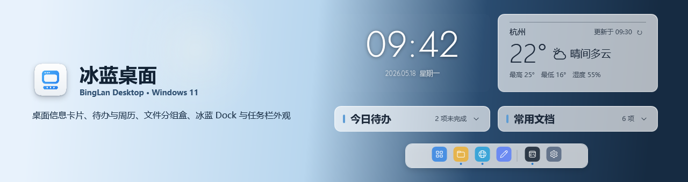
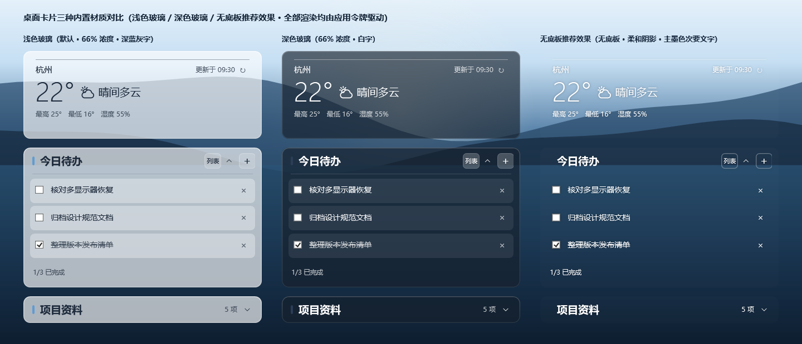
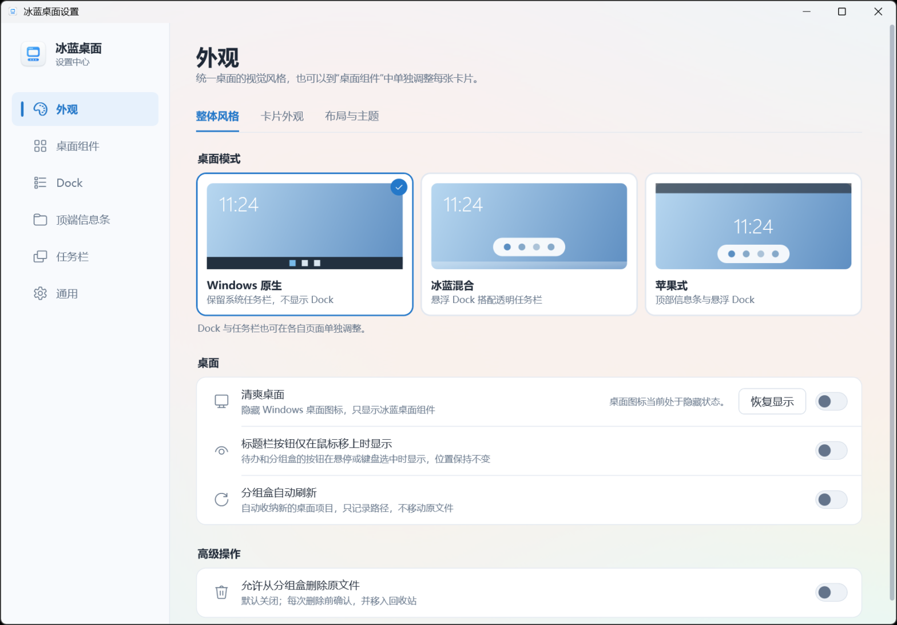

<div align="center">

<p align="center">
  
</p>

# 冰蓝桌面

[English](README_en.md) · [下载](https://github.com/keros68/binglan/releases/latest) · [快速开始](#快速开始) · [使用说明](docs/USER-GUIDE.md) · [开发说明](docs/DEVELOPMENT.md) · [许可证](#许可证)

**在一个应用里管理 Windows 11 桌面上的信息卡片、待办、文件分组、Dock 和任务栏。**

</div>

冰蓝桌面是基于 .NET 10 与 WPF 的 Windows 11 桌面伴侣，替代原先分别用于桌面信息、文件收纳、Dock 和任务栏美化的多个工具。所有模块共用一个进程、一个托盘图标和一个设置中心。

<p align="center">
  
</p>

## 功能

- **桌面信息**：时间日期、问候语、天气、CPU / RAM / 网络为独立卡片，字体、字号、颜色和位置可分别调整；时间日期提供经典、极简大数字、日期海报、纵向数字四种排版预设，可调整水平对齐、12/24 小时制与日期显示。卡片固定在桌面层，不会盖住其他程序窗口，Win+D 后仍保持可见。
- **待办与便签**：待办卡片可在今日列表和多周日历（1–5 周，带农历）之间切换，两者共用同一批任务，并可折叠为带未完成数量摘要（全部完成时显示“已全部完成”）的标题栏。支持截止日期与时间、行程、倒数日、关联文件、单条右键「跨天常驻」与卡片级「未完成待办跨天保留」（未完成前不随日期刷走），临近截止的事项自动高亮。便签支持多行文字。
- **文件收纳盒**：把桌面上的常用文件、文件夹和软件归类映射进盒子，按类型自动整理，支持手动调整及按名称、按类型、按修改时间（新的在前）排序，可折叠为带条目数量摘要的标题栏（收起状态下支持可选开启**悬停标题栏自动展开**，与“鼠标离开后自动收起”搭配成抽屉式自动展开/收回；把文件拖到标题条也可临时展开放入）；支持**组合收纳盒**（把多个盒子拖放叠合或右键合并为左侧竖排标签页，支持点击/可选悬停切页、拖文件悬停标签跨页投放、移出单页或拆分为独立收纳盒，各页保留独立分类规则与视图）和逐盒开启**平时全透明（移入显示）**（空闲时整盒全透明露出壁纸，鼠标移入、拖入文件、按临时浮起快捷键或在设置中选中时平滑显现）；另支持逐盒开启鼠标离开 5 秒自动收起、**贴边隐藏**（可在设置中心「桌面卡片 → 文件收纳盒」、卡片右键菜单开启，或直接把未锁定的收纳盒拖到屏幕左右外侧边松手自动贴边——按住 `Alt` 跳过；吸附屏幕左右外侧边为 6 DIP 标签色条，透明余量点击穿透；鼠标贴屏幕最外侧边悬停约 250 ms 或从外部拖文件靠近约 80 ms 滑出、离开自动收回，多屏排除内边、全屏暂停）与临时“保持展开”图钉、多选、批量移除和转移、空格预览（兼容本机已运行的 QuickLook），以及全局快捷键（默认 `Ctrl+Alt+Space`）**不回桌面临时浮起文件收纳盒并直接拖出文件**。只记路径，不搬原文件；删除原文件为默认关闭的可选功能，移入回收站前每次确认。
- **快捷入口**：一排线条图标，默认为此电脑、桌面、文档、下载、图片、回收站，图标、名称和位置均可自定义。在“桌面卡片”页关闭后，重启仍保持隐藏。
- **冰蓝总览卡**（快速找应用、翻常用文件夹的全局面板）可通过 Dock、托盘、顶部信息条居中搜索入口或全局快捷键（默认 `Ctrl+Alt+F`，不依赖顶栏随时生效）打开：顶部并列「应用」「文件」「我的分组」三个主入口并记住上次停留位置，右上角支持「保持打开」图钉以便连续操作；应用页提供 7 个精简通用大类（不足 3 项自动折叠至「其他」）与 A–Z 视图、手动改类与来源筛选；文件页整合系统常用位置、**自定义收藏常用文件夹**、文件收纳盒、可关闭的 Windows 最近使用及按文件形态分类，支持面板内只读展开目录、直接把文件拖给背后软件、`Ctrl+C` 复制文件、空格 QuickLook 预览与图标/列表视图切换；我的分组支持应用、文件与文件夹混排以及就地重命名/删除分组。内置本机桌面、开始菜单、Windows 索引与可选 Everything 的跨类型去重搜索（拼音首字母、本机打开频次加权与无清空顶栏筛选）、固定或从 Dock 取消固定、发送到文件收纳盒以及保持文字可读的清透/磨砂与自定义玻璃外观。
- **隐藏桌面图标与自定义快捷键**：在「设置 → 桌面方案」可开启“隐藏 Windows 桌面图标”（关闭或退出软件自动恢复），并可选开启默认关闭的“双击桌面空白处切换桌面图标”（仅在桌面空白处双击生效，不拦截桌面原生点击）。在「设置 → 通用设置 → 快捷键」和「冰蓝总览卡」页可统一录制或清空全局快捷键，覆盖冰蓝总览卡、直接打开常用文件夹、临时浮起文件收纳盒、隐藏/显示全部桌面组件、快速新建待办和隐藏 Windows 桌面图标模式下临时切回原生图标（全屏游戏/视频自动跳过，冲突时区分提示本程序内占用或其他程序占用）。
- **冰蓝 Dock**：固定应用与运行中的应用分区显示，支持未读提醒、窗口切换和可选的 macOS 式悬停放大（默认关闭，强度 1.2–1.7 倍可调）。开始菜单、冰蓝总览卡和显示桌面入口可分别隐藏，任务视图入口默认关闭。用「添加到 Dock…」可固定回收站、此电脑、下载等系统位置，也可直接拖入桌面上的回收站或此电脑图标。拖入程序、文件或文件夹到空白处即可固定，把文件拖到应用图标上可直接用该应用打开（在运行中的应用上悬停约 0.5 秒可抬起窗口）；放不下时自动缩小图标并可横向滚动；隐藏时缩成可拖动的小把手，悬停或拖入文件时展开。
- **任务栏**：保持默认、透明、模糊或智能隐藏。退出或异常结束后恢复原状态。
- **任务栏位置**：在 Windows 设置中换边，冰蓝按工作区和识别到的任务栏边位让开空间。冰蓝设置内可打开 Windows 任务栏设置。
- **顶部信息条**：屏幕最上方的满宽状态栏，提供 **Mac 极简 / 均衡 / 信息流** 三档分层预设（逐模块拉开密度：Mac 极简为天气仅温度、性能仅 CPU、极简周几时间、消息提示仅应用图标与侧边放大镜；均衡为温度+现象、CPU+下行、日期时间不含农历与居中搜索条；信息流保留完整详情），并自动将 Weixin、WeChat Work/WXWork、DingtalkLauncher 等常见程序名规范为“微信”“企业微信”“钉钉”等中文名称；点击音量、电量、网络在顶栏正下方弹出**冰蓝自有轻量控制浮层**（与输入法、日历、待办统一采用冰蓝透明磨砂玻璃，鼠标移出 1.5 秒或切窗口自动收起，不弹出底部原生任务栏：声音浮层支持主音量/静音/输出设备切换/应用分音量，并支持顶栏音量图标滚轮调音量与中键静音；电量浮层支持剩余时间/电源模式三档/笔记本内置屏亮度；网络浮层支持当前连接详情/断开与已保存 WLAN 一键切换，右键仍保留打开 Windows 快速设置）；音量静音仅显示静音图标、悬停看详情；在「设置 → 顶部信息条」可通过所见即所得的**模拟顶栏拖拽编辑器**自由拖拽排序、左右互移、隐藏/启用模块，点击胶囊即可单独调整各模块显示样式（时钟/天气/性能三档、消息提示仅图标或带名称、音量/网络/电量/托盘仅图标、输入法仅中/英徽标，以及把搜索在“居中搜索条”和 Mac Spotlight 式“右侧放大镜图标”间自由切换），桌面顶栏右键模块也支持一键切换样式或隐藏；搜索入口默认触发冰蓝总览卡，也可按需开启「搜索入口直接弹出搜索框」（原生冰蓝磨砂玻璃风格，优先搜索本机应用与文件，无匹配时自动衔接默认浏览器网页搜索或直达网址，支持必应 / Google / 百度 / 自定义搜索引擎）。可选“苹果式”桌面模式。
- **外设电量（本融合版扩展，非上游功能）**：顶部信息条可选模块（默认关闭），显示鼠标、耳机、键盘、手柄等无线外设的电量：每台设备以「种类图标＋百分比」显示（种类图标区分鼠标/耳机/键盘/手柄/手机），点击弹出逐台明细（连接方式、电压、充电/休眠状态与按历史估算的剩余时长），低电与充满时弹托盘气泡提醒；刷新间隔可在顶栏设置里调。读数来自随包的 `BatteryEngine.dll`（BatteryHub 读数引擎的融合构建），缺失时模块安静停用。融合版仅供自用，不分发。
- **多显示器**：卡片按显示器组合分别记住位置，拔掉外接屏后自动收拢到剩余屏幕，接回后恢复原位；也可在「设置 → 桌面方案」按需开启「每屏独立桌面卡片」，为每台副屏单独配置桌面卡片、快捷入口与布局预设（默认关闭且单屏零负担，副屏断开时销毁窗口并在重连后自动恢复位置与尺寸）。
- **外观**：所有全局与各部分外观设置集中在“外观样式”页——支持浅色玻璃、深色玻璃、纯透明（无底板）三种材质与一键纯透明推荐效果，下方“各部分外观”固定列出桌面卡片、冰蓝总览卡、冰蓝 Dock、顶部信息条的状态并支持就地展开自定义或一键恢复跟随；另提供四套横竖屏布局预设、卡片间自动留白、网格对齐，以及从 Rainmeter 皮肤只读导入字体和配色。主题可导出分享，不含称呼、城市、待办和文件路径。
- **设置中心**：左侧导航不分组命名：首页「桌面方案」在最上，接着按屏幕位置从上到下依次是桌面卡片、顶部信息条、冰蓝 Dock、Windows 任务栏，再是冰蓝总览卡和外观样式，最后一条分隔线之后是通用设置三组共八页，记住上次打开的页面（旧配置自动迁移，不出现空白页）；首页提供「我想…」常用任务直达入口（换外观、开关 Dock/顶栏、设天气城市、改快捷键、隐藏桌面图标、整理桌面文件）；总览卡、Dock、顶部信息条页仅留一行外观摘要与“去调整 ›”入口直达外观样式页；“桌面卡片”页提供清晰的左侧选中指示与列表溢出提示，详情顶部固定操作栏直接露出改名（文件收纳盒/待办/便签与桌面卡片双向同步，自动清理不可见控制字符并防同类型重名，右键列表条目可快速重命名）、显示/隐藏、锁定位置、恢复默认位置与删除/从桌面移除；每页低频项折叠在“更多选项”中，支持搜索（Ctrl+F，保留“桌面组件”“顶栏与底栏”“清爽桌面”“分组盒”“速览”“Dock 外观”“顶栏颜色”“总览卡透明”等旧词与同义词）并自动展开定位。

<p align="center">
  
</p>

各功能的详细用法见[使用说明](docs/USER-GUIDE.md)。

<p align="center">
  
</p>

## 快速开始

稳定版：[v0.6.0](https://github.com/keros68/binglan/releases/tag/v0.6.0) · [安装版](https://github.com/keros68/binglan/releases/download/v0.6.0/BingLan-Setup-0.6.0.exe) · [免安装版](https://github.com/keros68/binglan/releases/download/v0.6.0/BingLan-0.6.0-portable.zip)。另附[兼容性验收工具](https://github.com/keros68/binglan/releases/download/v0.2.52/BingLan-0.2.52-tray-preview.zip)，使用步骤见[托盘验收说明](docs/TRAY-PREVIEW.md)。

1. 打开 [Releases](https://github.com/keros68/binglan/releases/latest)，下载 `BingLan-Setup-*.exe`（安装版）或 `BingLan-*-portable.zip`（免安装版）。
2. 安装版运行安装包，按当前用户安装，不需要管理员权限；免安装版解压到任意文件夹后运行其中的 `BingLan.exe`。两者均自带 .NET 运行时，尚未加入代码签名，首次运行需按 Windows 提示手动放行。
3. 免安装版更新时重新下载 zip 覆盖，不要使用应用内“下载并安装”（它安装的是安装版）；与已安装版本不要同时运行。
4. 首次启动后按引导选择布局和常用应用。之后可从托盘图标或卡片右键菜单打开设置中心。
5. 卸载安装版：在设置“通用设置”页展开“更多选项”点“卸载…”，或在开始菜单搜索“卸载冰蓝桌面”；免安装版退出后删除文件夹即可。

系统要求：Windows 11 x64；Windows 10 版本 2004 及以上可安装使用，任务栏样式（透明、模糊、自动隐藏）已接入但尚未经 Windows 10 真机验证，设置窗口不显示 Mica 材质。各模块的详细用法见[使用说明](docs/USER-GUIDE.md)。

## 隐私

- 不采集遥测；待办、便签、文件路径、应用列表和窗口标题只保存在本机 `%LOCALAPPDATA%\BingLanWidgets`。
- 天气城市由用户手动搜索选择。国内省市区县在内置离线城市库里搜索，不联网；境外地名才使用 OpenStreetMap Nominatim，且请求只发送搜索关键词和所选地点的坐标，不使用 IP 或设备位置。天气数据来自 Open-Meteo。
- 每天自动检查一次新版本（可在设置“通用设置”页关闭），只向 GitHub 查询版本号；发现新版本只提示，由你决定是否下载安装。
- 文件收纳盒的添加、排序和移除只改变映射，不移动、重命名或删除原文件。

## 从源码构建

依赖 .NET 10 SDK、PowerShell 7；打安装包另需 Inno Setup 6 和 Visual Studio 2022 C++ 生成工具。

```powershell
dotnet build .\BingLan.slnx -c Release
dotnet run --project .\tests\BingLan.SmokeTests\BingLan.SmokeTests.csproj -c Release
pwsh -NoProfile -File .\installer\build.ps1 -Version 0.6.0
```

完整测试命令、技术方案和当前实现见[开发说明](docs/DEVELOPMENT.md)，安装包细节见[安装包](docs/INSTALLER.md)。

## 作者与参与

作者 keros68，仓库地址 <https://github.com/keros68/binglan>，欢迎提交 PR。设置中心“通用设置”页“更多选项”中的“打开仓库”可直接打开该页面。

## 许可证

[PolyForm Noncommercial 1.0.0](LICENSE)，Copyright © 2026 keros68。可用于个人学习、研究和其他非商业用途；商业使用需另行取得授权。内置字体和其他第三方内容的许可见 [NOTICE](NOTICE.md)。
