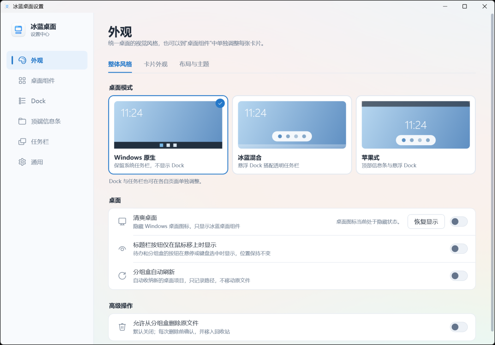

<div align="center">


# 冰蓝桌面

[English](README_en.md) · [下载](https://github.com/keros68/binglan/releases/latest) · [快速开始](#快速开始) · [使用说明](docs/USER-GUIDE.md) · [开发说明](docs/DEVELOPMENT.md) · [许可证](#许可证)

**在一个应用里管理 Windows 11 桌面上的信息卡片、待办、文件分组、Dock 和任务栏。**

</div>

冰蓝桌面是基于 .NET 10 与 WPF 的 Windows 11 桌面伴侣，替代原先分别用于桌面信息、文件收纳、Dock 和任务栏美化的多个工具。所有模块共用一个进程、一个托盘图标和一个设置中心。

<p align="center">
  
</p>

## 功能

- **桌面信息**：时间日期、问候语、天气、CPU / RAM / 网络为独立卡片，字体、字号、颜色和位置可分别调整。卡片固定在桌面层，不会盖住其他程序窗口，Win+D 后仍保持可见。
- **待办与便签**：待办卡片可在今日列表和多周日历（1–5 周，带农历）之间切换，两者共用同一批任务。支持截止日期与时间、行程、倒数日，以及关联文件，临近截止的事项自动高亮。便签支持多行文字。
- **分组盒**：把桌面上的文件、文件夹和软件映射进盒子，按类型自动整理，可折叠为标题栏，支持多选、批量移除和转移。只记录路径，不移动原文件；删除原文件为默认关闭的可选功能，移入回收站前每次确认。
- **快捷入口**：一排线条图标，默认为此电脑、桌面、文档、下载、图片、回收站，图标、名称和位置均可自定义。
- **冰蓝 Dock**：固定应用与运行中的应用分区显示，支持未读提醒、窗口切换、开始菜单入口和“显示桌面”按钮。拖入程序、文件或文件夹即可固定；放不下时自动缩小图标并可横向滚动；隐藏时缩成可拖动的小把手，悬停展开。
- **任务栏**：保持默认、透明、模糊或智能隐藏。退出或异常结束后恢复原状态。
- **顶端信息条**：屏幕顶端的满宽状态条，显示时间、待办概要、天气、性能、电量、音量、网络和输入法，并带搜索入口。可搜索桌面、开始菜单应用和 Windows 已索引的文件，支持拼音首字母和全局热键（默认 Ctrl+Alt+F），可选接入 Everything。可选“苹果式”桌面模式。
- **多显示器**：卡片按显示器组合分别记住位置；拔掉外接屏后自动收拢到剩余屏幕，接回后恢复原位。
- **外观**：浅色玻璃、深色玻璃、无底板三种材质，四套横竖屏布局预设，可选网格对齐，可从 Rainmeter 皮肤只读导入字体和配色。主题可导出分享，不含称呼、城市、待办和文件路径。
- **设置中心**：桌面方案、外观样式、桌面组件、顶栏底栏、通用设置五页，支持搜索（Ctrl+F）。

各功能的详细用法见[使用说明](docs/USER-GUIDE.md)。

<p align="center">
  
</p>

## 快速开始

稳定版：[v0.2.65](https://github.com/keros68/binglan/releases/tag/v0.2.65) · [安装版](https://github.com/keros68/binglan/releases/download/v0.2.65/BingLan-Setup-0.2.65.exe) · [免安装版](https://github.com/keros68/binglan/releases/download/v0.2.65/BingLan-0.2.65-portable.zip)。另附[兼容性验收工具](https://github.com/keros68/binglan/releases/download/v0.2.52/BingLan-0.2.52-tray-preview.zip)，使用步骤见[托盘验收说明](docs/TRAY-PREVIEW.md)。

1. 打开 [Releases](https://github.com/keros68/binglan/releases/latest)，下载 `BingLan-Setup-*.exe`（安装版）或 `BingLan-*-portable.zip`（免安装版）。
2. 安装版运行安装包，按当前用户安装，不需要管理员权限；免安装版解压到任意文件夹后运行其中的 `BingLan.exe`。两者均自带 .NET 运行时，尚未加入代码签名，首次运行需按 Windows 提示手动放行。
3. 免安装版更新时重新下载 zip 覆盖，不要使用应用内“下载并安装”（它安装的是安装版）；与已安装版本不要同时运行。
4. 首次启动后按引导选择布局和常用应用。之后可从托盘图标或卡片右键菜单打开设置中心。
5. 卸载安装版：在设置“通用设置”页最下方点“卸载…”，或在开始菜单搜索“卸载冰蓝桌面”；免安装版退出后删除文件夹即可。

系统要求：Windows 11 x64；Windows 10 版本 2004 及以上可安装使用，任务栏样式（透明、模糊、自动隐藏）已接入但尚未经 Windows 10 真机验证，设置窗口不显示 Mica 材质。各模块的详细用法见[使用说明](docs/USER-GUIDE.md)。

## 隐私

- 不采集遥测；待办、便签、文件路径、应用列表和窗口标题只保存在本机 `%LOCALAPPDATA%\BingLanWidgets`。
- 天气城市由用户手动搜索选择。国内省市区县在内置离线城市库里搜索，不联网；境外地名才使用 OpenStreetMap Nominatim，且请求只发送搜索关键词和所选地点的坐标，不使用 IP 或设备位置。天气数据来自 Open-Meteo。
- 每天自动检查一次新版本（可在设置“通用设置”页关闭），只向 GitHub 查询版本号；发现新版本只提示，由你决定是否下载安装。
- 分组盒的添加、排序和移除只改变映射，不移动、重命名或删除原文件。

## 从源码构建

依赖 .NET 10 SDK、PowerShell 7；打安装包另需 Inno Setup 6 和 Visual Studio 2022 C++ 生成工具。

```powershell
dotnet build .\BingLan.slnx -c Release
dotnet run --project .\tests\BingLan.SmokeTests\BingLan.SmokeTests.csproj -c Release
pwsh -NoProfile -File .\installer\build.ps1 -Version 0.2.65
```

完整测试命令、技术方案和当前实现见[开发说明](docs/DEVELOPMENT.md)，安装包细节见[安装包](docs/INSTALLER.md)。

## 作者与参与

作者 keros68，仓库地址 <https://github.com/keros68/binglan>，欢迎提交 PR。设置中心“通用设置”页“启动与更新”区域的“打开仓库”可直接打开该页面。

## 许可证

[PolyForm Noncommercial 1.0.0](LICENSE)，Copyright © 2026 keros68。可用于个人学习、研究和其他非商业用途；商业使用需另行取得授权。内置字体和其他第三方内容的许可见 [NOTICE](NOTICE.md)。
