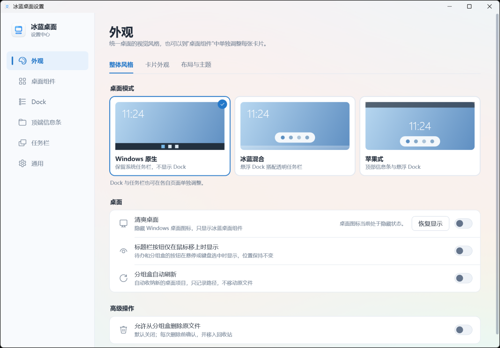

<div align="center">


# BingLan Desktop

[简体中文](README.md) · [Download](https://github.com/keros68/binglan/releases/latest) · [Get started](#get-started) · [User guide (Chinese)](docs/USER-GUIDE.md) · [Development (Chinese)](docs/DEVELOPMENT.md) · [License](#license)

**Manage desktop info cards, to-dos, file groups, a dock, and the taskbar on Windows 11 from one app.**

</div>

BingLan Desktop (冰蓝桌面) is a Windows 11 desktop companion built with .NET 10 and WPF. It replaces separate tools for desktop info widgets, file organizing, a dock, and taskbar styling. All modules share one process, one tray icon, and one settings window.

<p align="center">
  
</p>

## Features

- **Desktop info**: time and date, greeting, weather, and CPU / RAM / network are separate cards, each with its own font, size, colour, and position. Cards sit on the desktop layer, never cover other app windows, and stay visible after Win+D.
- **To-dos and notes**: the to-do card switches between today's list and a 1–5-week calendar with lunar dates; both share the same tasks. Supports deadlines with optional times, events, countdowns, and linked files, and highlights tasks close to their deadline. Notes support multiline text.
- **File groups**: map desktop files, folders, and apps into boxes, sorted by type automatically, foldable to a title bar, with multi-select, bulk remove, and move between boxes. Boxes record paths only and never move original files. Deleting originals is an optional setting, off by default; each deletion asks first and goes to the Recycle Bin.
- **Quick launch**: a row of line icons for This PC, Desktop, Documents, Downloads, Pictures, and the Recycle Bin by default; icons, names, and targets are customizable.
- **Dock**: pinned and running apps in separate sections, with unread badges, window switching, a Start menu button, and a Show desktop button. Drag a program, file, or folder onto it to pin it. When apps do not fit, icons shrink and the dock scrolls horizontally. With smart hide, it collapses into a draggable handle and expands on hover.
- **Taskbar**: default, transparent, blurred, or auto-hide. The original state comes back on exit or after a crash.
- **Top bar**: a full-width status bar at the top of the screen showing time, to-do summary, weather, performance, battery, volume, network, and input method, with a search field. Searches desktop entries, Start-menu apps, and files indexed by Windows; supports pinyin initials and a global hotkey (Ctrl+Alt+F by default); Everything integration is optional. An optional "Apple-style" desktop mode is available.
- **Multiple monitors**: cards remember a position for each monitor setup. When an external monitor is unplugged, cards move onto the remaining screens and return to their places when it is plugged back in.
- **Look**: light glass, dark glass, or no backing; four layout presets for landscape and portrait; optional grid snapping; read-only import of fonts and colours from a Rainmeter skin. Themes can be exported and shared without names, cities, to-dos, or file paths.
- **Settings**: five pages (Desktop scheme, Appearance, Desktop components, Top & bottom bars, General) with search (Ctrl+F).

See the [user guide (Chinese)](docs/USER-GUIDE.md) for details.

<p align="center">
  
</p>

The interface is in Simplified Chinese.

## Get started

Stable version: [v0.2.65](https://github.com/keros68/binglan/releases/tag/v0.2.65) · [Installer](https://github.com/keros68/binglan/releases/download/v0.2.65/BingLan-Setup-0.2.65.exe) · [Portable](https://github.com/keros68/binglan/releases/download/v0.2.65/BingLan-0.2.65-portable.zip). A standalone [compatibility tool](https://github.com/keros68/binglan/releases/download/v0.2.52/BingLan-0.2.52-tray-preview.zip) is also available; see the [guide (Chinese)](docs/TRAY-PREVIEW.md).

1. Open [Releases](https://github.com/keros68/binglan/releases/latest) and download `BingLan-Setup-*.exe` (installer) or `BingLan-*-portable.zip` (portable).
2. Installer: run it — it installs for the current user and needs no administrator rights. Portable: unzip anywhere and run `BingLan.exe` inside. Both include the .NET runtime and are not code-signed yet, so Windows asks for confirmation on first run.
3. Portable: to update, download the new zip and overwrite — don't use the in-app update (it installs the setup version); don't run the portable and installed copies at the same time.
4. On first launch, pick a layout and your common apps. Settings open from the tray icon or any card's right-click menu.
5. Uninstall (installer version): click “卸载…” at the bottom of Settings → 通用设置, or search the Start menu for “卸载冰蓝桌面”. Portable: exit the app and delete its folder.

Requires Windows 11 x64. Windows 10 version 2004 or later also works. The taskbar styles (transparent, blur, auto-hide) are implemented for it but not yet verified on a real Windows 10 machine, and the settings window has no Mica material. See the [user guide (Chinese)](docs/USER-GUIDE.md) for details.

## Privacy

- No telemetry. To-dos, notes, file paths, app lists, and window titles stay on this computer under `%LOCALAPPDATA%\BingLanWidgets`.
- The weather city is chosen by searching by hand. Chinese provinces, cities, and districts are found in a bundled offline list without any network access; other places fall back to OpenStreetMap Nominatim, and requests send only the search text and the chosen city's coordinates. IP address and device location are never used.
- Once a day the app asks GitHub for the latest version number (can be turned off under Settings → 通用). A new version is only announced; you decide whether to download and install it.
- Adding, sorting, or removing items in a file group changes only the mapping. Original files are never moved, renamed, or deleted.

## Build from source

Requires the .NET 10 SDK and PowerShell 7. Building the installer also needs Inno Setup 6 and the Visual Studio 2022 C++ build tools.

```powershell
dotnet build .\BingLan.slnx -c Release
dotnet run --project .\tests\BingLan.SmokeTests\BingLan.SmokeTests.csproj -c Release
pwsh -NoProfile -File .\installer\build.ps1 -Version 0.2.65
```

Full test commands, the technical design, and the current implementation are in the [development notes (Chinese)](docs/DEVELOPMENT.md); installer details are in [docs/INSTALLER.md](docs/INSTALLER.md).

## License

[PolyForm Noncommercial 1.0.0](LICENSE), Copyright © 2026 keros68. Free for personal learning, research, and other noncommercial use; commercial use requires a separate licence. Bundled fonts and other third-party content are listed in [NOTICE](NOTICE.md).
